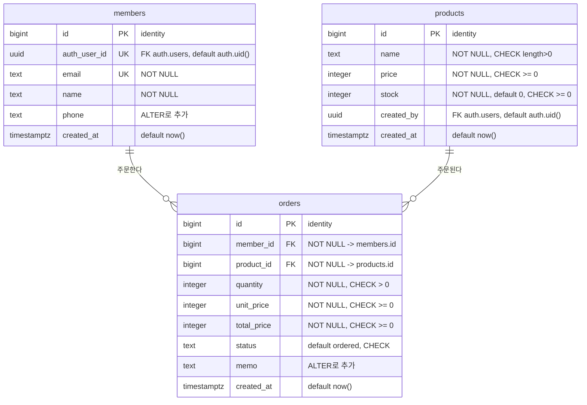
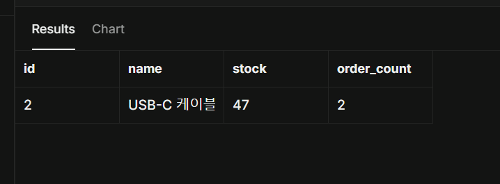
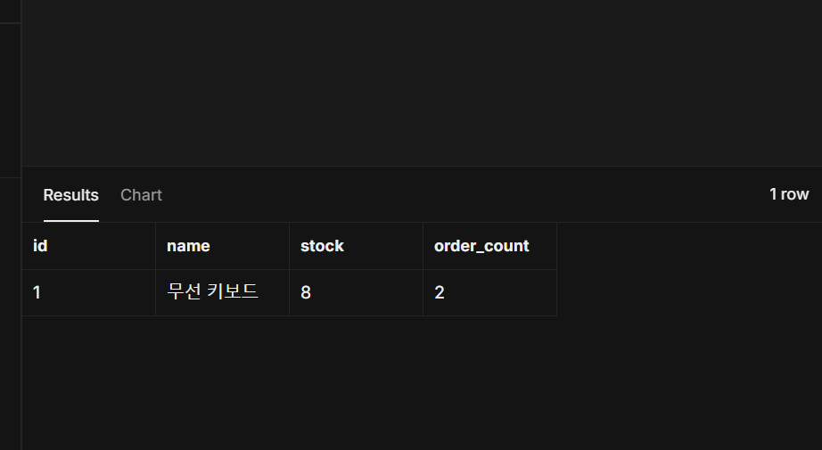
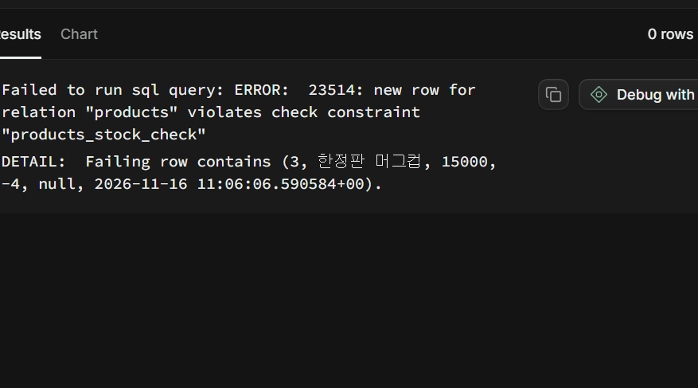
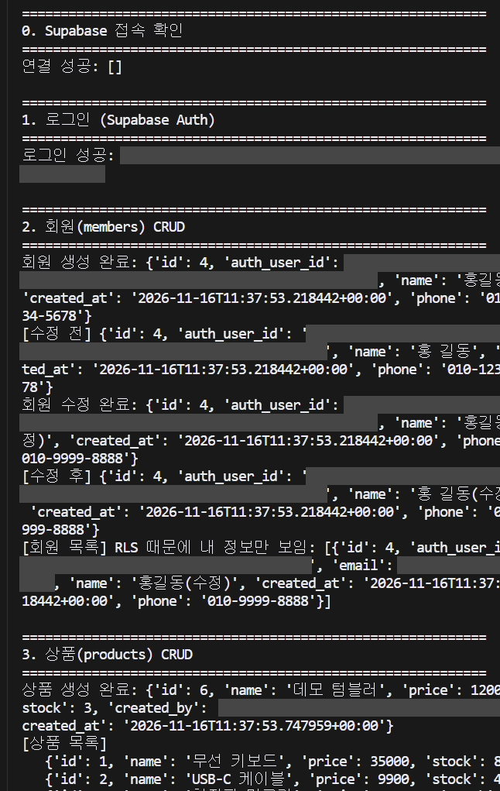
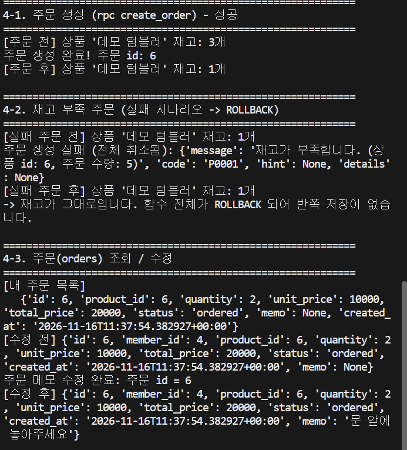

# db-ai-shop : Supabase로 만드는 쇼핑몰 DB (회원 / 상품 / 주문)

Supabase(PostgreSQL)에 **회원(members) · 상품(products) · 주문(orders)** 3개 테이블을 설계하고,
**Supabase Python SDK**로 CRUD를 수행하는 과제입니다.

- PK / FK / NOT NULL / UNIQUE / CHECK 제약조건, 네이밍 규칙과 정규화 고려
- 트랜잭션 `BEGIN / COMMIT / ROLLBACK` 실습 + 실패 시나리오 재현
- 주문 생성은 PostgreSQL 함수 + `supabase.rpc()` 로 **원자적(한 번에)** 처리 → 동시 주문에도 초과 판매 없음
- RLS(행 단위 보안) + Supabase Auth 로그인, 예외 처리(`try / except`)

---

## 1. 프로젝트 구조

```
01-db-supabase-shop/
├── sql/
│   ├── 01_schema.sql            # 테이블 생성(CREATE), ALTER 예시, 제약조건 위반 테스트
│   ├── 02_rls.sql               # RLS 활성화 + 정책
│   ├── 03_functions.sql         # create_order / cancel_order 트랜잭션 함수
│   ├── 04_transaction_test.sql  # BEGIN/COMMIT, BEGIN/ROLLBACK, 실패 시나리오
│   └── 05_seed.sql              # 테스트 데이터
├── db.py          # .env 를 읽어 Supabase 클라이언트 생성
├── auth.py        # 회원가입 / 로그인 / 로그아웃
├── members.py     # 회원 CRUD
├── products.py    # 상품 CRUD
├── orders.py      # 주문 CRUD (생성/취소는 rpc)
├── main.py        # 전체 시나리오 데모 (uv run main.py)
├── images/        # README 용 캡처 이미지
├── .env.example   # 환경변수 예시 (실제 .env 는 GitHub 에 올리지 않음)
├── pyproject.toml / uv.lock
```

## 2. 실행 환경 준비

### 2-1. Supabase 프로젝트 만들기
1. [supabase.com](https://supabase.com) 로그인 → **New project** 생성 (DB 비밀번호는 따로 잘 보관)
2. **Authentication > Sign In / Providers > Email** 에서 테스트 편의를 위해 **Confirm email 을 끔**
   (켜 두면 회원가입 후 메일 인증을 해야 로그인됩니다)

### 2-2. SQL 실행 (SQL Editor 에서 순서대로)
| 순서 | 파일 | 내용 |
|---|---|---|
| 1 | `sql/01_schema.sql` | 테이블 3개 생성 + ALTER 예시 + 컬럼 확인 |
| 2 | `sql/02_rls.sql` | RLS 켜기 + 정책 생성 |
| 3 | `sql/03_functions.sql` | 주문 생성/취소 함수 생성 |
| 4 | `sql/05_seed.sql` | 테스트 데이터 입력 |
| 5 | `sql/04_transaction_test.sql` | 트랜잭션 실습 (블록을 하나씩 선택해서 실행) |
| (선택) | `01_schema.sql` 맨 아래 | 제약조건 위반 쿼리 주석을 하나씩 풀어 에러 확인 |

### 2-3. Python 환경
```bash
uv sync                  # pyproject.toml / uv.lock 기준으로 .venv 생성 + 패키지 설치
cp .env.example .env     # (Windows PowerShell: copy .env.example .env)
```
`.env` 에 **Project Settings > API** 의 값을 넣습니다.
```
SUPABASE_URL=https://xxxx.supabase.co
SUPABASE_PUBLISHABLE_KEY=sb_publishable_...
DEMO_EMAIL=demo_user@example.com
DEMO_PASSWORD=password1234
```
> publishable key 는 RLS 정책을 적용받는 "일반 사용자용" 키입니다. 모든 권한을 가진 service role key 는 사용하지 않습니다.

### 2-4. 실행
```bash
uv run main.py
```

> 이 프로젝트는 처음에 `uv init --python 3.13` 으로 만들고 `uv add supabase python-dotenv` 로 패키지를 추가했습니다.

---

## 3. 테이블 설계

### 3-1. ER 다이어그램



### 3-2. members (회원)
| 컬럼 | 타입 | 키 | 제약조건 / 기본값 | 설명 |
|---|---|---|---|---|
| id | bigint | **PK** | generated always as identity | 회원 번호 (자동 증가) |
| auth_user_id | uuid | **FK** → auth.users(id) | UNIQUE, default `auth.uid()`, on delete cascade | 로그인 계정과 연결 |
| email | text | | NOT NULL, UNIQUE (`members_email_unique`) | 이메일 |
| name | text | | NOT NULL | 이름 |
| phone | text | | (ALTER TABLE 로 추가) | 전화번호 |
| created_at | timestamptz | | NOT NULL, default `now()` | 가입 시각 |

### 3-3. products (상품)
| 컬럼 | 타입 | 키 | 제약조건 / 기본값 | 설명 |
|---|---|---|---|---|
| id | bigint | **PK** | generated always as identity | 상품 번호 |
| name | text | | NOT NULL, CHECK `length(name) > 0` (ALTER 로 추가) | 상품명 |
| price | integer | | NOT NULL, CHECK `price >= 0` | 가격 |
| stock | integer | | NOT NULL, default 0, CHECK `stock >= 0` | 재고 |
| created_by | uuid | **FK** → auth.users(id) | default `auth.uid()`, on delete set null | 등록한 사용자 (SQL 로 넣으면 null = 관리자) |
| created_at | timestamptz | | NOT NULL, default `now()` | 등록 시각 |

### 3-4. orders (주문)
| 컬럼 | 타입 | 키 | 제약조건 / 기본값 | 설명 |
|---|---|---|---|---|
| id | bigint | **PK** | generated always as identity | 주문 번호 |
| member_id | bigint | **FK** → members(id) | NOT NULL, on delete cascade | 주문한 회원 |
| product_id | bigint | **FK** → products(id) | NOT NULL, on delete restrict | 주문한 상품 |
| quantity | integer | | NOT NULL, CHECK `quantity > 0` | 수량 |
| unit_price | integer | | NOT NULL, CHECK `>= 0` | 주문 당시 단가 |
| total_price | integer | | NOT NULL, CHECK `>= 0` | 총 금액 (단가 × 수량) |
| status | text | | NOT NULL, default `'ordered'`, CHECK `in ('ordered','cancelled')` | 주문 상태 |
| memo | text | | (ALTER TABLE 로 추가) | 배송 요청사항 |
| created_at | timestamptz | | NOT NULL, default `now()` | 주문 시각 |

### 3-5. 네이밍 규칙 & 정규화
- **네이밍**: 테이블은 소문자 복수형(`members`), 컬럼은 snake_case(`created_at`), FK 는 `단수형_id`(`member_id`), 제약조건은 `테이블_컬럼_종류`(`products_price_check`).
- **정규화**: 회원 정보는 `members`, 상품 정보는 `products` 에만 저장하고 `orders` 는 id 로만 연결 → 같은 정보를 여러 곳에 복사하지 않음.
- **의도적인 예외**: `orders.unit_price` 는 "주문했을 때의 가격"이라는 주문 고유의 사실이라 저장 (상품 가격이 나중에 바뀌어도 주문 금액은 그대로).
- **FK 삭제 규칙**: 회원 삭제 시 주문도 삭제(`cascade`), 주문 기록이 있는 상품은 삭제 금지(`restrict`).
- 한 주문 = 상품 1종류인 단순 구조. 장바구니처럼 여러 상품을 담으려면 `order_items` 테이블로 분리하는 것이 다음 단계입니다.


---

## 4. RLS(행 단위 보안) 정책

로그인한 사용자는 `authenticated` 역할이 되고, `auth.uid()` 가 그 사용자의 id 입니다.

| 테이블 | 동작 | 대상 | 조건 | 의미 |
|---|---|---|---|---|
| members | select / insert / update / delete | authenticated | `auth.uid() = auth_user_id` | 내 회원 정보만 |
| products | select | authenticated | `true` | 로그인하면 모든 상품 조회 |
| products | insert / update / delete | authenticated | `auth.uid() = created_by` | 내가 등록한 상품만 관리. SQL로 넣은 상품(created_by null)은 관리자만 SQL Editor에서 관리 |
| orders | select | authenticated | `member_id in (내 members.id)` | 내 주문만 조회 |
| orders | delete | authenticated | 내 주문 **and** `status = 'cancelled'` | 취소한 주문만 삭제 가능 |
| orders | insert | (정책 없음) | - | 직접 insert 금지 → 반드시 `create_order` 함수로만 주문 |
| orders | update | (정책 없음) | - | 직접 수정 금지 → `update_order_memo` 함수로 메모만 수정 |

- 정책이 없는 동작은 모두 거부됩니다. 로그인하지 않으면 아무 데이터도 볼 수 없습니다.
- RLS 에 막힌 update/delete 는 에러 대신 **빈 결과(`[]`)** 가 오므로, Python 코드에서 `if not response.data:` 로 확인합니다.
- `create_order` / `cancel_order` 는 `security definer` 로 실행되어, 정책으로 막아 둔 재고 차감·주문 저장을 **함수 안에서만** 할 수 있습니다.


---

## 5. 트랜잭션

### 5-1. 왜 필요한가
주문 1건은 ① 재고 확인 → ② 재고 차감 → ③ 주문 저장 의 3단계입니다.
- ②까지만 성공하고 ③에서 실패하면 → 재고만 줄어든 **반쪽 저장**
- 두 사람이 동시에 ①을 통과하면 → 재고 1개를 둘 다 사는 **초과 판매**

### 5-2. 해결: PostgreSQL 함수 + `supabase.rpc()`
Supabase Python SDK에는 트랜잭션 기능이 없으므로, 3단계를 `create_order` 함수 하나에 넣었습니다.
PostgreSQL 함수는 **통째로 하나의 트랜잭션**이라 중간에 `raise exception` 이 나면 전부 ROLLBACK 됩니다.

```sql
-- 재고 확인 + 차감을 한 문장으로 (조건부 UPDATE)
update products
set stock = stock - p_quantity
where id = p_product_id
  and stock >= p_quantity      -- 재고가 충분할 때만 수정됨
returning price into v_price;

if not found then
    raise exception '재고가 부족합니다. ...';   -- 함수 전체 ROLLBACK
end if;
```
- **동시성**: UPDATE 는 해당 행을 잠급니다. 동시에 온 두 번째 주문은 첫 번째가 끝날 때까지 기다린 뒤
  줄어든 최신 재고로 `stock >= p_quantity` 를 다시 검사하므로 초과 판매가 일어나지 않습니다.
- 추가 안전장치로 `CHECK (stock >= 0)` 제약조건이 있어 재고가 음수가 될 수 없습니다.

```python
response = supabase.rpc("create_order", {"p_product_id": 1, "p_quantity": 2}).execute()
print(response.data)   # 새 주문 id
```

### 5-3. SQL 실습 (`sql/04_transaction_test.sql`)
| 시나리오 | 내용 | 결과 |
|---|---|---|
| 1. COMMIT | 재고 차감 + 주문 저장 후 `commit` | 재고 50→47, 주문 수 +1 |
| 2. ROLLBACK | 같은 작업 후 `rollback` | 전/후 SELECT 결과 동일 |
| 3. 실패 시나리오 | 재고 1개 상품을 5개 차감 → `products_stock_check` 위반 | 먼저 넣은 주문 insert 까지 취소, 재고 1 그대로 |
| 4. 함수 ROLLBACK | Python 에서 재고 부족 주문 | 실행 전/후 재고 동일 |





---

## 6. Python CRUD 실행 결과

`uv run main.py` 실행 시 순서:
1. 접속 확인 → 로그인(없으면 회원가입)
2. **회원** 등록 → 조회 → 수정(전/후 비교)
3. **상품** 등록 → 목록/단건 조회 → 수정(전/후 비교) → 음수 가격 등록 시도(CHECK 에러 처리)
4. **주문** `rpc create_order` 성공(재고 3→1) → 재고 부족 주문 실패(재고 1 그대로) → 조회 → 메모 수정 → 취소(재고 1→3) → 삭제
5. 상품 삭제 → 회원 삭제 → 로그아웃

| 테이블 | Create | Read | Update | Delete |
|---|---|---|---|---|
| members | `create_member` (insert) | `get_members`, `get_member`, `get_my_member` | `update_member` | `delete_member` |
| products | `create_product` (insert) | `get_products`, `get_product` | `update_product` | `delete_product` |
| orders | `create_order` (**rpc**) | `get_orders`, `get_order` | `update_order_memo` (**rpc**), `cancel_order` (**rpc**) | `delete_order` |

모든 API 호출은 `try / except` 로 감싸서, 실패하면 프로그램이 멈추지 않고 `"... 실패: 원인"` 메시지를 출력합니다.




> **캡처 안내**: 위 이미지들은 `images/` 폴더에 같은 파일 이름으로 저장하면 README 에 표시됩니다.

---

## 7. 한계와 개선할 점
- `orders` 는 사용자가 직접 insert/update 할 수 없고, 생성·메모 수정·취소를 모두 DB 함수(rpc)로만 처리합니다.
  함수마다 바꿀 수 있는 컬럼이 정해져 있어 수량/가격을 임의로 바꿀 수 없습니다.
- 주문 1건에 상품 1종류만 담을 수 있습니다 (`order_items` 분리로 확장 가능).
