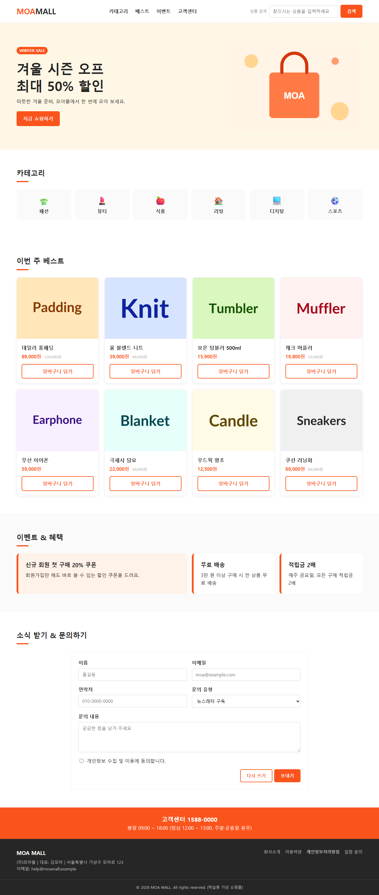
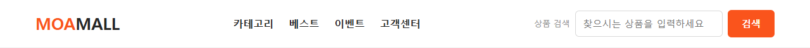
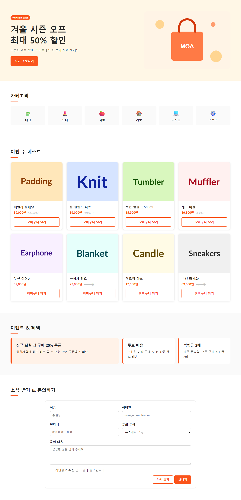
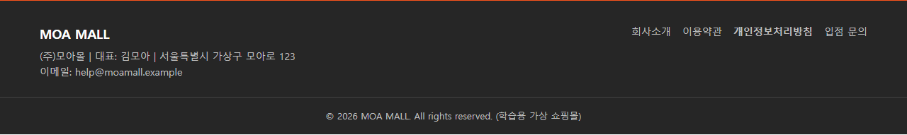

# MOA MALL - 쇼핑몰 랜딩 페이지 클론 코딩

HTML 시맨틱 태그와 CSS(박스 모델, Flexbox, Grid, 미디어 쿼리)만으로 만든 **가상의 쇼핑몰 "MOA MALL"** 메인 페이지입니다.
실제 회사의 로고·브랜드는 사용하지 않았고, 상품 이미지는 `placehold.co` 플레이스홀더와 직접 그린 SVG를 사용했습니다.

## 실행 방법

1. 이 폴더를 내려받습니다.
2. `index.html` 파일을 더블클릭하거나, VS Code의 Live Server로 엽니다.
3. 브라우저 창 너비를 줄이거나 개발자 도구(F12) → 기기 툴바(Ctrl+Shift+M)로 모바일/태블릿/데스크톱 화면을 확인합니다.

> 상품 이미지는 `https://placehold.co` 에서 불러오므로 인터넷 연결이 필요합니다.

## 폴더 구조

```text
02-clone-coding/
├── index.html        # 페이지 마크업 (시맨틱 태그)
├── README.md
├── css/
│   └── style.css     # 외부 스타일시트 (섹션별 주석으로 구분)
└── images/
    └── hero.svg      # 히어로 배너 일러스트 (직접 그린 SVG)
```

## 페이지 구성

| 영역 | 태그 | 내용 |
|---|---|---|
| 헤더 | `header > h1 + nav > ul > li > a` + `form` | 로고, 주 메뉴, 상품 검색 |
| 히어로 | `main > section` | 시즌 세일 배너 |
| 카테고리 | `section > ul` | 6개 카테고리 바로가기 |
| 베스트 상품 | `section > article.card` x 8 | 상품 카드 그리드 |
| 이벤트 | `section > article` | 쿠폰 / 무료 배송 / 적립금 |
| 문의 폼 | `section > form` | input(text/email/tel/checkbox), select, textarea, button |
| 사이드 | `aside` | 고객센터 안내 |
| 푸터 | `footer > address + ul` | 회사 정보, 링크, `&copy;` 저작권 |

## 평가 항목별 구현 내용

### 1. 시맨틱 태그
- `header`, `nav`, `main`, `section`, `article`, `aside`, `footer`, `address`로 영역의 의미를 표현했습니다.
- 의미 없는 묶음(레이아웃용)에만 `div`를 사용했습니다.
- 제목 계층: `h1`(로고) → `h2`(각 섹션 제목) → `h3`(상품명, 이벤트명) 순서를 지켰습니다.

### 2. 박스 모델
- `* { box-sizing: border-box; }` 로 padding/border를 너비에 포함시켜 계산을 단순하게 했습니다.
- `.container` 에 `max-width + margin: 0 auto + padding` 으로 가운데 정렬과 좌우 여백을 만들었습니다.
- 카드, 버튼, 폼 입력칸에 `padding`, `border`, `border-radius`, `margin`을 사용했습니다.

### 3. Flexbox
- 헤더(로고/메뉴/검색), 내비게이션 메뉴, 히어로(글/이미지), 푸터(정보/링크)를 Flex로 배치했습니다.
- `flex-direction`, `justify-content: space-between`, `align-items`, `flex-wrap`, `gap`, `flex: 1` 사용.

### 4. Grid
- 상품 카드: `grid-template-columns: repeat(N, 1fr)` 로 **1열(모바일) → 2열(태블릿) → 4열(데스크톱)**.
- 카테고리: 3칸 → 6칸.
- 이벤트: 큰 카드에 `grid-column: span 2` 를 주어 2칸을 차지하게 했습니다.
- 문의 폼: 태블릿 이상에서 2열, 긴 입력칸(`.full`)은 `span 2`.

### 5. 반응형 (여러 브레이크포인트)
- **모바일 우선(mobile-first)**: 기본 CSS = 모바일(~767px) 기준.
- `@media screen and (min-width: 768px)` → 태블릿(768~1023px)
- `@media screen and (min-width: 1024px)` → 데스크톱(1024px~)
- 모바일에서는 헤더 요소가 세로로 쌓이고 메뉴는 줄바꿈되며, 화면이 넓어질수록 가로 배치로 바뀝니다.

### 6. 접근성 (심화)
- `<html lang="ko">` 로 문서 언어 지정.
- 모든 `img`에 내용을 설명하는 `alt` 속성 (예: `alt="베이지색 롱패딩 상품 사진"`).
- 모든 입력 요소에 `label` 연결: `for`/`id` 방식(검색, 이름, 이메일 등)과 감싸기 방식(체크박스) 두 가지 사용.
- 입력칸 `:focus` 시 테두리 색을 바꿔 키보드 사용자도 현재 위치를 알 수 있게 했습니다.
- `type="email"`, `type="tel"`, `required` 로 브라우저 기본 입력 검사를 활용했습니다.

### 7. 재사용 가능한 스타일 구조 (심화)
CSS를 **리셋 → 공통 → 헤더 → 메인 섹션 → 푸터 → 미디어 쿼리** 순서로 나누고 주석으로 구분했습니다.
여러 곳에서 반복되는 스타일은 공통 클래스로 만들어 HTML에 class만 붙이면 재사용되도록 했습니다.

| 공통 클래스 | 역할 | 사용 위치 |
|---|---|---|
| `.container` | 최대 너비 1200px + 가운데 정렬 | 모든 섹션 |
| `.btn` | 버튼 기본 모양 (padding, 둥근 모서리, hover 전환) | 검색, 히어로, 카드, 폼 |
| `.btn-primary` | 주황색 채움 버튼 (`.btn`과 함께) | 검색, 쇼핑하기, 보내기 |
| `.btn-outline` | 테두리 버튼 (`.btn`과 함께) | 장바구니, 다시 쓰기 |
| `.section-title` | 섹션 제목 + `::after` 밑줄 | 모든 섹션 제목 |
| `.card` | 테두리·그림자·hover 효과가 있는 상자 | 상품 카드 |

## 화면 캡처

> 아래 이미지는 브라우저에서 캡처한 뒤 `images/` 폴더에 같은 이름으로 저장하면 표시됩니다.

### 전체 화면


### 헤더


### 메인


### 푸터


## 사용 기술
- HTML5 (시맨틱 태그, 폼)
- CSS3 (박스 모델, Flexbox, Grid, 미디어 쿼리, 가상 클래스/가상 요소, transition)
- 프레임워크/라이브러리 없이 순수 HTML + CSS
