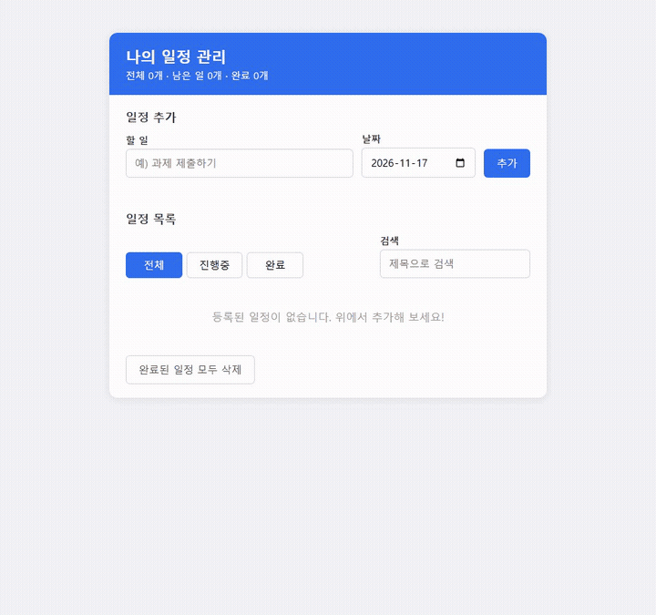

# 일정 관리 Todo 리스트 (HTML + CSS + JavaScript)

순수 JavaScript로 만든 일정 관리 앱입니다. 일정을 **추가 · 조회 · 수정 · 삭제**하고 완료 여부를 관리할 수 있습니다.
프레임워크 없이 변수, 함수, 배열, 객체, 고차 함수(forEach / map / filter / find / some / reduce), DOM 조작, 이벤트 처리만 사용했습니다.

## 실행 방법

`index.html` 을 브라우저로 열면 바로 실행됩니다. (VS Code Live Server 사용 가능)
데이터는 브라우저의 `localStorage` 에 저장되어 새로고침해도 유지됩니다.

## 시연 영상

> 시연 순서 (약 36초): 빈 값 오류 → 일정 3개 추가(버튼 / Enter) → 완료 체크 → 필터(진행중·완료·전체) → 검색 → 인라인 수정(Enter 저장, Esc 취소) → 삭제 → 완료된 일정 모두 삭제 → 새로고침 후에도 유지(localStorage)



- 원본 영상(mp4): [media/todo_demo.mp4](media/todo_demo.mp4)
- 브라우저 자동 조작(Playwright)으로 녹화했습니다. 삭제 시 뜨는 확인 창(confirm)은 브라우저 기본 창이라 녹화 화면에는 보이지 않고, "확인"을 누른 결과만 보입니다.

## 주요 기능

| 기능 | 설명 |
|---|---|
| 일정 추가 | 할 일 + 날짜 입력 후 `추가` 버튼 또는 Enter. 빈 값이면 빨간 오류 문구 표시 |
| 일정 조회 | 전체 / 진행중 / 완료 필터, 제목 검색 (입력할 때마다 즉시 반영) |
| 일정 수정 | `수정` 클릭 → 그 줄이 입력칸으로 바뀜(인라인 수정) → `저장`/Enter 또는 `취소`/Esc |
| 일정 삭제 | `삭제` 클릭 → 확인 창 → 삭제. `완료된 일정 모두 삭제` 버튼도 제공 |
| 완료 토글 | 체크박스로 완료/미완료 전환, 완료된 일정은 회색 취소선 |
| 개수 표시 | 전체 / 남은 일 / 완료 개수를 상단에 표시 |
| 저장 | localStorage에 저장 → 새로고침해도 유지 |

## 파일 구조

```text
03-todo-js/
├── index.html      # 화면 뼈대 (폼, 필터, 검색, 빈 ul)
├── README.md
├── css/
│   └── style.css   # 스타일 (모바일 우선 + 768px 이상 태블릿/데스크톱)
└── js/
    └── todo.js     # 데이터 + 기능 + 화면 그리기 + 이벤트
```

## 코드 구조 (todo.js)

```text
1. 데이터       todos 배열, currentFilter, searchKeyword, editingId
2. DOM 요소     getElementById로 가져오기
3. 저장         saveTodos()  → localStorage
4. 검사         validate()   → 빈 값 방지
5~9. 기능       addTodo / toggleTodo / startEdit·saveEdit·cancelEdit / deleteTodo·clearCompleted
10. 조회        getVisibleTodos() → filter 두 번 (상태 필터 + 검색)
11. 개수        updateCount()     → reduce
12~13. 요소 생성 createButton / createTodoItem / createEditItem (createElement + textContent)
14. 화면 그리기  render()          → 배열을 map으로 li 배열로 바꿔 append
15~19. 이벤트    submit, 목록 click 위임, keydown, 필터, 검색 input
20. 최초 실행    오늘 날짜 기본값 + render()
```

**데이터 흐름**: 사용자 동작 → 이벤트 → `todos` 배열 변경 → `saveTodos()` → `render()` 로 화면 전체 다시 그림.
화면을 직접 고치지 않고 항상 배열(데이터)만 고치기 때문에, 화면과 데이터가 어긋나지 않습니다.

일정 하나의 데이터 모양:

```js
{
    id: 1763251200000,           // Date.now()로 만든 고유 번호
    title: "과제 제출하기",
    date: "2026-11-16",
    completed: false,
    createdAt: "2026-11-16T03:00:00.000Z"
}
```

## 평가 항목별 구현

### 변수 / 함수 / 배열 / 객체
- `const`(바뀌지 않는 값, DOM 요소)와 `let`(바뀌는 상태: todos, currentFilter, editingId)을 구분.
- 기능마다 함수로 분리 (`addTodo`, `deleteTodo`, `render` ...).
- 일정 목록 = 객체의 배열.

### 고차 함수
| 메서드 | 사용 위치 |
|---|---|
| `filter` | 상태 필터, 검색, 삭제(해당 id 제외), 완료 일정 일괄 삭제 |
| `map` | 일정 객체 배열 → `li` 요소 배열 |
| `find` | id로 일정 찾기 (`findTodo`) |
| `reduce` | 완료 개수 계산 |
| `some` | 완료된 일정이 하나라도 있는지 검사 |
| `forEach` | 필터 버튼의 active 클래스 정리 |

### DOM 조작 (CRUD)
- 생성: `document.createElement`, `append`
- 조회: `getElementById`, `querySelector`, `querySelectorAll`
- 수정: `textContent`, `classList.add/remove`, `value`
- 삭제: 목록 비우기(`textContent = ""`) 후 다시 그리기
- 사용자 입력은 `innerHTML` 대신 `textContent` 로 넣어, `<script>` 같은 태그를 입력해도 실행되지 않습니다.

### 이벤트
- `submit` + `e.preventDefault()` (새로고침 방지), `click`, `input`(검색), `keydown`(Enter/Esc).

### [심화] 이벤트 위임
- 일정 `li` 마다 리스너를 달지 않고, 부모 `ul#todoList` **하나에만** click 리스너를 등록했습니다.
- 버튼에 `data-action`(toggle / edit / delete / save / cancel), `li` 에 `data-id` 를 넣어 두고,
  `e.target.closest("[data-action]")` 으로 어떤 버튼인지, `closest(".todo-item")` 의 `dataset.id` 로 어떤 일정인지 알아냅니다.
- 이벤트 버블링(자식 → 부모 전파)을 이용한 방식입니다.

### [심화] 성능
- 리스너가 일정 개수와 상관없이 **항상 1개** → 일정이 많아져도 메모리 사용이 늘지 않고,
  `render()` 로 `li` 를 새로 만들어도 리스너를 다시 붙일 필요가 없습니다.
- `map` 으로 만든 `li` 배열을 `todoList.append(...items)` 로 **한 번에** 추가해 DOM 변경 횟수를 줄였습니다.

## 사용 기술
- HTML5, CSS3 (Flexbox, 미디어 쿼리), JavaScript (ES6+)
- DOM API, Event Listener, Event Delegation, localStorage
