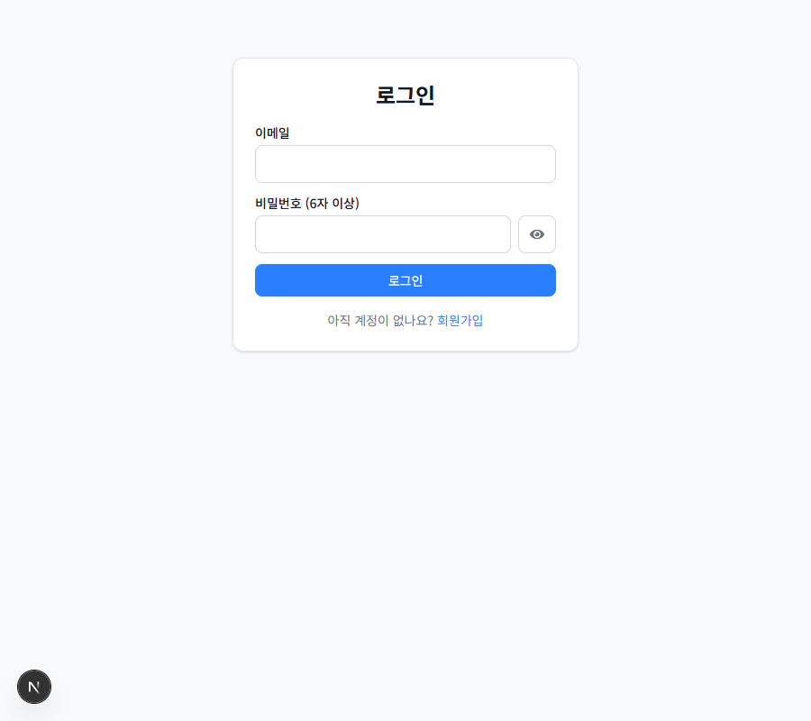
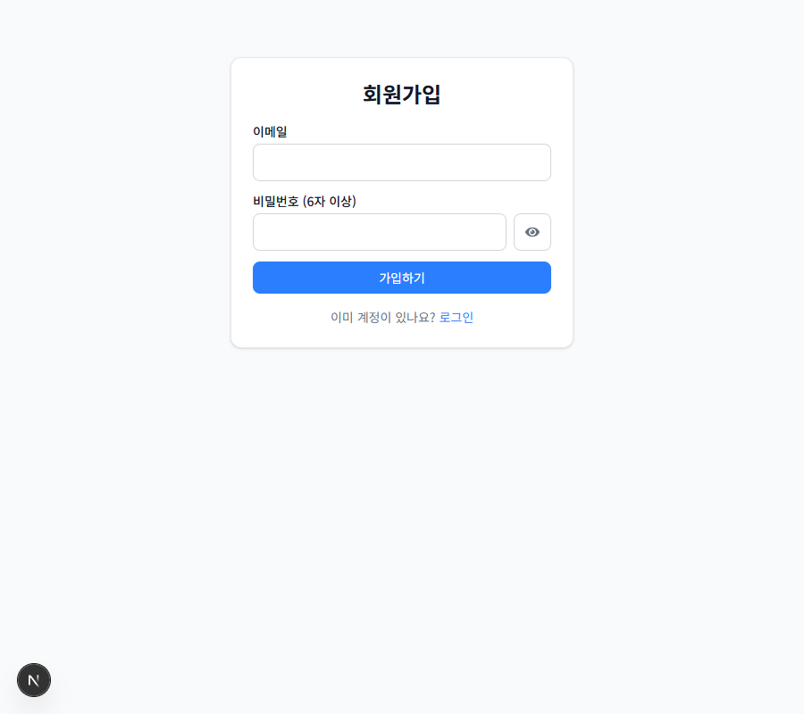
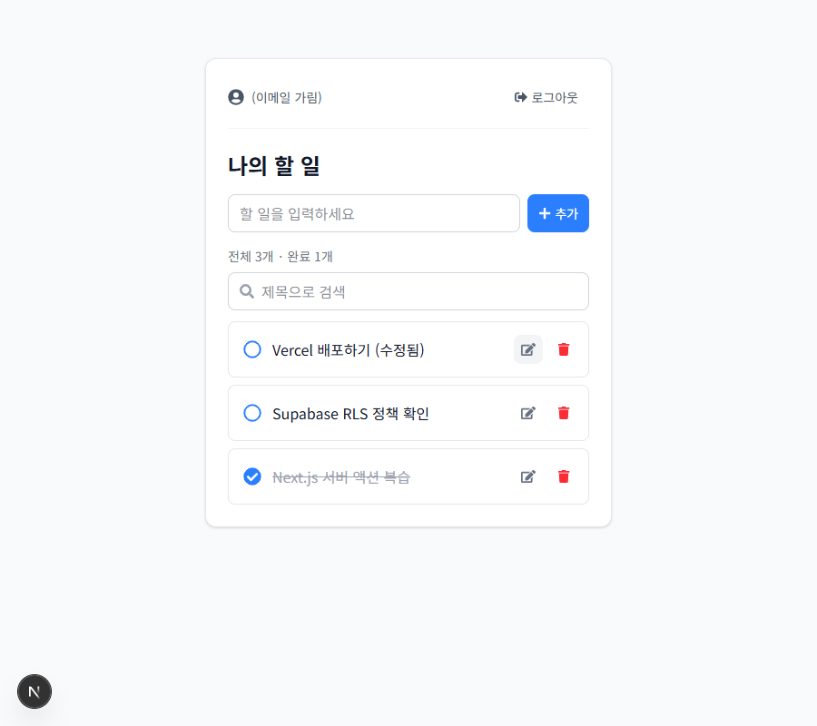
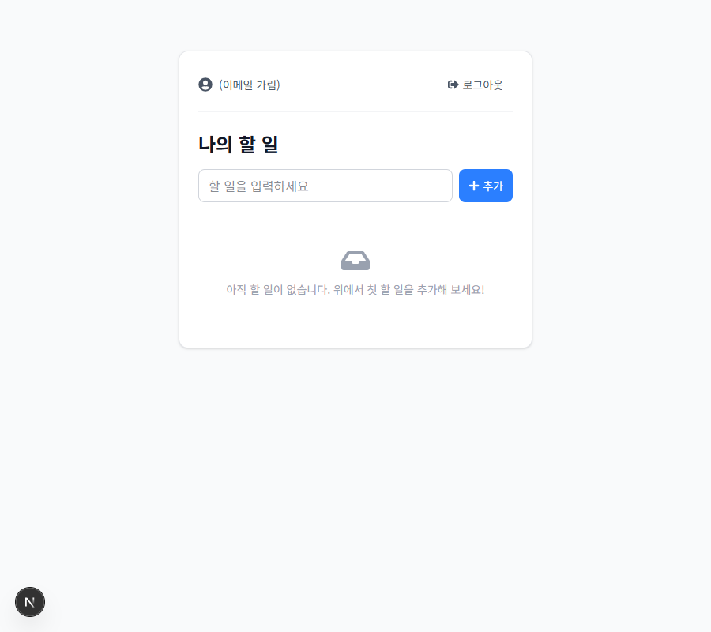
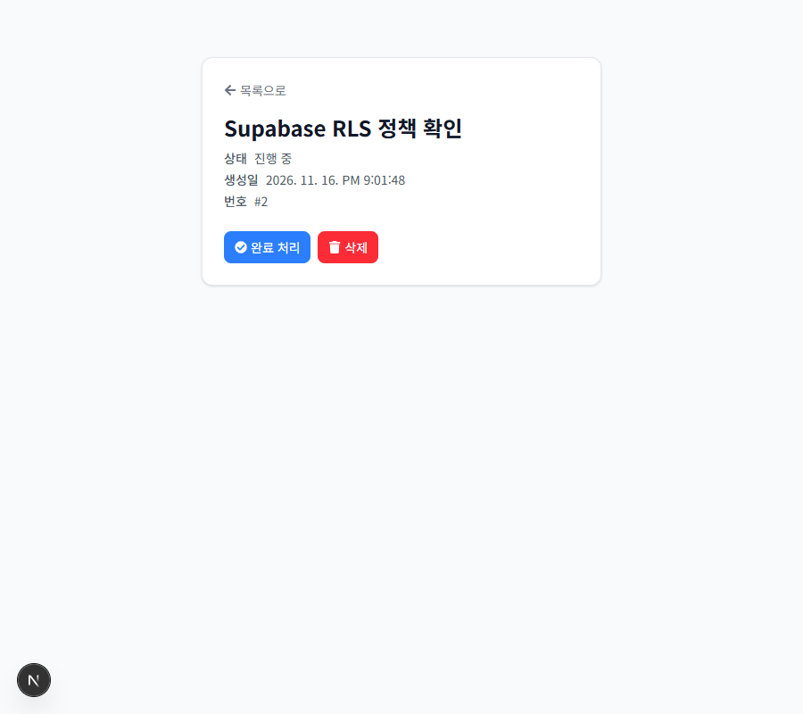

# Supabase Todo (Next.js App Router + Supabase Auth)

프론트엔드 응용(React/Next.js) 과제 — 회원가입/로그인한 사용자가 **자기 할 일만** 관리하는 Todo 앱입니다.

- 배포 URL: https://ax-study-eight.vercel.app
- GitHub: https://github.com/whatukknow/ax_study/tree/main/ch2_ch3_assignments/05-nextjs-todo-supabase

## 1. 주요 기능

| 구분 | 내용 |
|---|---|
| 인증 | Supabase Auth 이메일/비밀번호 회원가입(`signUp`), 로그인(`signInWithPassword`), 로그아웃(`signOut`) — 모두 서버 액션 |
| 접근 제어 | `middleware.ts` 가 비로그인 사용자의 `/todos...` 접근을 `/login` 으로, 로그인 사용자의 `/login`·`/signup` 접근을 `/todos` 로 리다이렉트 |
| Todo CRUD | 추가 / 완료 토글 / 제목 수정 / 삭제 (서버 액션 + `revalidatePath`) |
| 회원별 데이터 | DB 의 RLS 정책 4개가 `auth.uid() = user_id` 인 행만 허용 |
| 검색 | 목록 화면에서 제목 검색 (입력 후 0.3초 디바운스, `useEffect` 클린업으로 타이머 정리) |
| 라우팅 | `/` 랜딩, `/login`, `/signup`, `/todos` 목록, `/todos/[id]` 동적 상세(없으면 `notFound()`) |
| 상태 UI | 로딩(`loading.tsx` 스켈레톤 + 버튼 "추가 중..."), 성공(목록), 오류(`error.tsx`, `ErrorMessage`), 빈 데이터(`EmptyState`) |

## 2. 기술 스택

Next.js 16 (App Router, `src/` 없음) · React 19 · TypeScript · Tailwind CSS 4 + `cn()`(clsx + tailwind-merge) · react-icons · `@supabase/supabase-js` + `@supabase/ssr` · Vercel 배포

## 3. 폴더 구조

```
05-nextjs-todo-supabase/
├─ app/
│  ├─ layout.tsx              # 루트 레이아웃 (폰트, 메타데이터)
│  ├─ page.tsx                # / 랜딩 (로그인 상태면 /todos 로 이동)
│  ├─ globals.css             # Tailwind 불러오기
│  ├─ actions.ts              # 'use server' : login, signup, logout, addTodo, toggleTodo, updateTodoTitle, deleteTodo...
│  ├─ login/page.tsx          # 로그인 페이지
│  ├─ signup/page.tsx         # 회원가입 페이지
│  ├─ todos/
│  │  ├─ page.tsx             # 목록 (서버에서 조회)
│  │  ├─ loading.tsx          # 로딩 스켈레톤
│  │  ├─ error.tsx            # 에러 화면 (다시 시도)
│  │  └─ [id]/
│  │     ├─ page.tsx          # 상세 (동적 라우트)
│  │     └─ not-found.tsx     # 상세 404
│  └─ components/
│     ├─ AuthForm.tsx         # 로그인/회원가입 공용 폼 (mode prop)
│     ├─ UserProfile.tsx      # 이메일 표시 + 로그아웃 + onAuthStateChange 구독
│     ├─ TodoInput.tsx        # 할 일 추가 폼
│     ├─ FilterableTodoList.tsx # 검색(디바운스) + 결과 목록
│     ├─ TodoList.tsx         # 목록 <ul>
│     ├─ TodoItem.tsx         # 한 줄 (토글/수정/삭제/상세 링크)
│     ├─ SubmitButton.tsx     # 전송 중 비활성화 버튼 (useFormStatus)
│     ├─ EmptyState.tsx       # 빈 데이터 안내
│     └─ ErrorMessage.tsx     # 오류 안내
├─ types/todo.ts              # Todo 인터페이스 (테이블 컬럼과 1:1)
├─ utils/
│  ├─ cn.ts                   # clsx + tailwind-merge
│  ├─ authMessages.ts         # ?error= 코드 → 한국어 문구
│  └─ supabase/
│     ├─ server.ts            # 서버 컴포넌트/서버 액션용 클라이언트 (쿠키)
│     ├─ client.ts            # 브라우저용 클라이언트
│     └─ middleware.ts        # updateSession: 세션 갱신 + 라우트 가드
├─ middleware.ts              # 루트 미들웨어 (updateSession 호출)
├─ supabase/schema.sql        # todos 테이블 + RLS 정책
├─ .env.example               # 환경 변수 견본
└─ package.json, tsconfig.json, next.config.ts, postcss.config.mjs, eslint.config.mjs
```

## 4. 서버 / 클라이언트 컴포넌트 구분 근거

원칙: **데이터 조회는 서버 컴포넌트**, **상태(useState)·효과(useEffect)·이벤트(onClick)가 필요한 곳만 `'use client'`**.

| 파일 | 종류 | 이유 |
|---|---|---|
| `app/page.tsx` | 서버 | 서버에서 `getUser()` 후 바로 `redirect` |
| `app/todos/page.tsx` | 서버 | 쿠키 세션으로 DB 조회 → 완성된 HTML 전송, 조회 로직 노출 없음 |
| `app/todos/[id]/page.tsx` | 서버 | id 로 한 건 조회, 없으면 `notFound()` |
| `app/login`, `app/signup` 페이지 | 서버 | `searchParams` 의 오류 코드를 읽어 문구로 변환만 함 |
| `loading.tsx`, `not-found.tsx` | 서버 | 정적인 화면 |
| `app/todos/error.tsx` | 클라이언트 | Next.js 규칙(에러 경계 + reset 버튼) |
| `TodoInput.tsx` | 서버 | `<form action={addTodo}>` 만 사용, 상태 불필요 (React 19 가 제출 후 입력 초기화) |
| `TodoList.tsx`, `EmptyState.tsx`, `ErrorMessage.tsx` | 공용(지시어 없음) | props 를 그리기만 함. 클라이언트 컴포넌트가 import 하면 클라이언트에서도 렌더링 |
| `TodoItem.tsx` | 클라이언트 | 수정 모드 `useState`, 버튼 `onClick` |
| `FilterableTodoList.tsx` | 클라이언트 | 검색어 `useState` + 디바운스 `useEffect`(클린업 `clearTimeout`) |
| `AuthForm.tsx` | 클라이언트 | 비밀번호 보기 토글 `useState` |
| `UserProfile.tsx` | 클라이언트 | `onAuthStateChange` 구독(`useEffect`) + 클린업 `unsubscribe()` |
| `SubmitButton.tsx` | 클라이언트 | `useFormStatus` 로 전송 중 상태 표시 |

### 훅 규칙 정리
- `FilterableTodoList`: `useEffect(..., [keyword])` — keyword 가 바뀔 때만 타이머를 새로 걸고, 이전 타이머는 클린업에서 `clearTimeout` (마지막 입력 후 0.3초 뒤 1번만 검색).
- `UserProfile`: `useEffect(..., [router])` — 마운트 시 1번 구독, 언마운트 시 `subscription.unsubscribe()` 로 리스너 누수 방지.
- `error.tsx`: `useEffect(() => console.error(error), [error])`.
- 훅은 모두 컴포넌트 최상단에서만 호출 (조건문/반복문 안에서 호출하지 않음).

## 5. 동시 사용자 / 데이터 분리 (충돌이 없는 이유)

1. **요청마다 새 Supabase 클라이언트**: `utils/supabase/server.ts` 의 `createClient()` 는 요청이 올 때마다 그 요청의 쿠키로 새로 만들어집니다. 전역 변수에 사용자 정보를 저장하지 않으므로 A·B 사용자가 동시에 접속해도 서로의 세션이 섞이지 않습니다.
2. **DB 가 최종 방어선(RLS)**: 모든 SELECT/INSERT/UPDATE/DELETE 는 `(select auth.uid()) = user_id` 정책을 통과해야 합니다. 앱 코드에 `user_id` 조건을 빠뜨려도 DB 가 남의 행을 돌려주지 않고, 남의 id 로 수정/삭제를 시도해도 0 행만 영향받습니다. 상세 페이지에서 남의 id 를 입력하면 404 가 됩니다.
3. **user_id 자동 입력**: 컬럼 기본값이 `auth.uid()` 라서 추가할 때 클라이언트가 user_id 를 조작할 수 없습니다 (INSERT 정책의 `with check` 도 막음).

## 6. 로컬 실행 방법

1. [Supabase](https://supabase.com) 에서 새 프로젝트 생성
2. 대시보드 **SQL Editor** 에 `supabase/schema.sql` 전체를 붙여넣고 **Run** → `todos` 테이블과 RLS 정책 4개 생성
3. (선택) **Authentication > Sign In / Providers > Email** 에서 "Confirm email" 을 끄면 가입 즉시 로그인됩니다. 켜 두면 가입 후 메일의 링크를 눌러야 로그인할 수 있습니다.
4. `.env.example` 을 복사해 `.env.local` 생성 후 값 입력 (Project Settings > API 의 Project URL, Publishable key)
   ```
   NEXT_PUBLIC_SUPABASE_URL=https://xxxx.supabase.co
   NEXT_PUBLIC_SUPABASE_PUBLISHABLE_KEY=sb_publishable_xxxx
   ```
5. 패키지 설치 및 실행
   ```bash
   npm install
   npm run dev
   ```
6. 브라우저에서 http://localhost:3000 접속 → 회원가입 → 할 일 추가

배포 전 확인: `npm run build` 가 오류 없이 끝나는지 확인합니다. (Next.js 16 은 "middleware → proxy" 이름 변경 경고를 띄우지만, 수업과 같이 `middleware.ts` 를 사용하며 동작에는 문제가 없습니다.)

## 7. Vercel 배포

1. GitHub 에 저장소를 만들고 push
   ```bash
   git init
   git add .
   git commit -m "feat: Next.js + Supabase Todo"
   git branch -M main
   git remote add origin https://github.com/<아이디>/<저장소>.git
   git push -u origin main
   ```
2. [Vercel](https://vercel.com) → **Add New > Project** → GitHub 저장소 **Import**
3. **Environment Variables** 에 `NEXT_PUBLIC_SUPABASE_URL`, `NEXT_PUBLIC_SUPABASE_PUBLISHABLE_KEY` 두 개 입력 → **Deploy**
4. 배포가 끝나면 Supabase 대시보드 **Authentication > URL Configuration** 에서
   - Site URL: `https://<배포주소>.vercel.app`
   - Redirect URLs: `https://<배포주소>.vercel.app/**` 추가
5. 배포 주소로 접속해 회원가입/로그인/CRUD 확인 후, 맨 위 "배포 URL" 을 채웁니다.

## 8. 실행 화면

| 화면 | 캡처 |
|---|---|
| 로그인 |  |
| 회원가입 |  |
| 목록 (성공) |  |
| 빈 목록 |  |
| 로딩 | (데이터가 빨리 와서 로딩 화면이 거의 보이지 않아 캡처 생략 · `app/todos/loading.tsx` 참고) |
| 상세 |  |
| 비로그인 접근 시 /login 이동 |  |

> 화면 위쪽의 로그인 이메일은 공개 저장소용으로 "(이메일 가림)" 처리했습니다.
